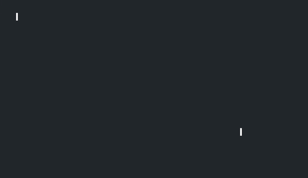

# Ghostty cursor shaders

Switch with `custom-shader` in `../config`.

## `proton_stream.glsl` (default)

A proton stream whips out to the cursor when it jumps.

## `cursor_warp.glsl`

Neovide-like trail (vendored, MIT).

