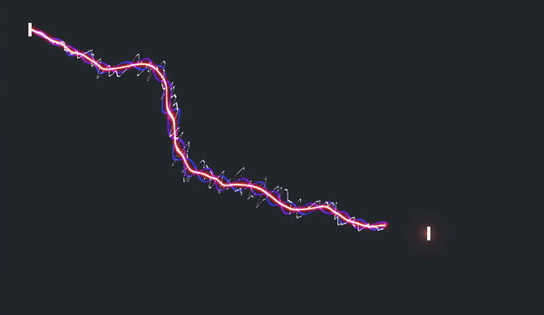

# Ghostty cursor shaders

- `proton_stream.glsl` (default): a proton stream whips out to the cursor when
  it jumps.
- `cursor_warp.glsl`: Neovide-like trail (vendored, MIT).

Switch with `custom-shader` in `../config`.

